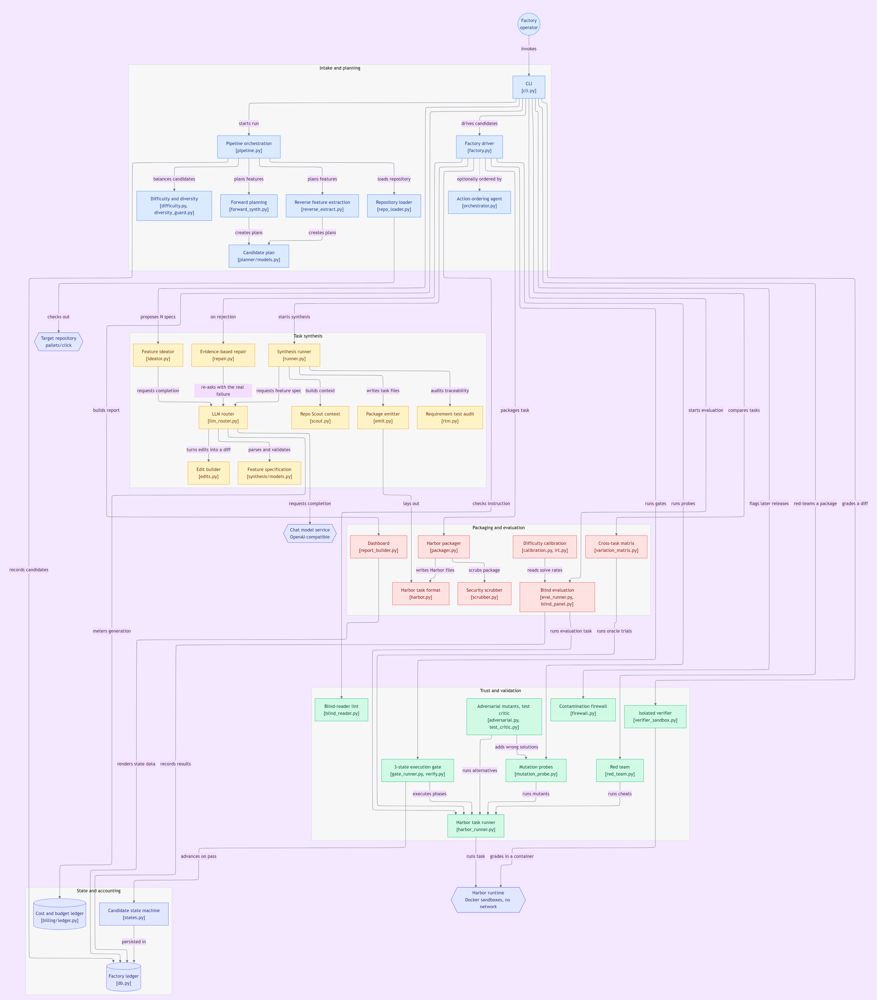
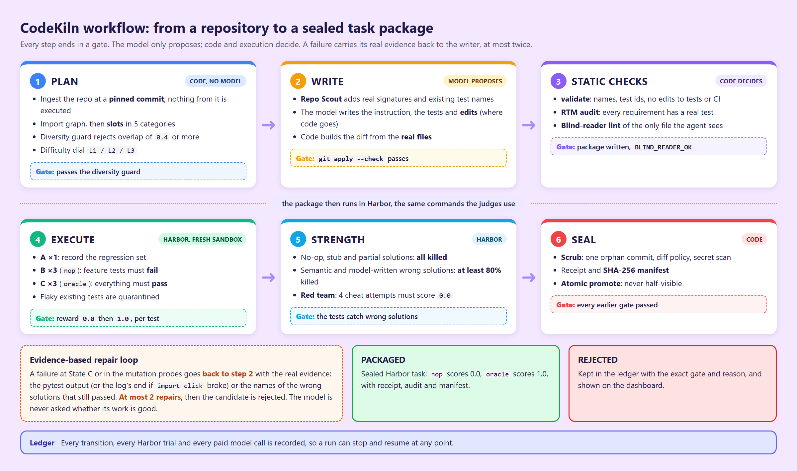

<h1 align="center">CodeKiln</h1>

<p align="center">
  <b>Turn a software repository into validated, tamper-resistant feature tasks<br>for evaluating AI coding agents.</b><br>
  <i>A model may propose. Only execution decides.</i>
</p>

<p align="center">
  <a href="https://github.com/loktrishal-05/CodeKiln/actions/workflows/ci.yml"></a>
  
  
  
  
  
</p>

<p align="center">
  <a href="#results">Results</a> &middot; <a href="#architecture">Architecture</a> &middot; <a href="#workflow">Workflow</a> &middot;
  <a href="#security-model">Security</a> &middot; <a href="#quick-start">Quick start</a> &middot; <a href="docs/TECHNICAL.md">Technical notes</a>
</p>

---

## Overview

AI coding agents need benchmark tasks that are **new**, **fair** and **hard to game**. CodeKiln reads a repository at a pinned commit, lets a model **propose** a feature (instruction, solution, tests), and then makes every claim earn its place by **running** it: in a no-network sandbox, repeatedly, against deliberately wrong solutions and cheating agents. The output is a [Harbor](https://harborframework.com) task package that the judges' own `harbor run -a nop` and `-a oracle` score as `0.0` and `1.0`.

> **One rule:** models propose; code and execution decide. No ledger status is ever set from what a model says.

## Results

A real run on `pallets/click` **8.5.1** with a free-tier model (`gpt-oss-120b` on Groq), Harbor 0.25 and Docker:

| Candidates | Packaged | Variation matrix | Red team | Model spend |
|:-:|:-:|:-:|:-:|:-:|
| 8 planned | **5** passed every gate | perfect diagonal, **0.00** on all 20 other cells | **20 / 20** cheats scored 0.0 | **$0** (free tier, fully metered) |

Each package scores `nop` **0.0** and `oracle` **1.0** under the real Harbor commands, with click's own 2,434 tests staying green. The three rejected candidates are kept with their exact reasons.

| Package | Category | Repairs | Mutants killed |
|---|---|:-:|:-:|
| `click-completion-enabled` | core logic | 0 | 100% |
| `click-parse-bool` | core logic | 2 | 100% |
| `click-parse-json-param` | core logic | 2 | 100% |
| `click-prompt-int-range` | API / CLI | 0 | 80% |
| `click-result-contains` | API / testing | 0 | 100% |

<p align="center">
  <br>
  <sub>Generated by <code>codekiln report</code>. The full offline dashboard is <a href="samples/factory_report.html"><code>samples/factory_report.html</code></a>.</sub>
</p>

Packages, Harbor results, the matrix and red-team reports are in [`samples/`](samples/).

## Architecture

A **host control plane** holds the secrets and makes every decision. An **execution plane** runs untrusted code in throwaway, no-network containers. Models are reachable only from the host.

<p align="center">
  <a href="docs/assets/architecture.png"></a><br>
  <sub>Click to enlarge. Blue: intake and planning &middot; amber: synthesis &middot; green: trust and validation &middot; red: packaging and evaluation &middot; indigo: state and accounting. Source: <a href="docs/assets/architecture.mmd"><code>architecture.mmd</code></a>.</sub>
</p>

## Workflow

<p align="center">
  <a href="docs/assets/workflow.png"></a>
</p>

Every candidate is a row in the ledger, and its status, not a model, picks its next stage, so a run can stop and resume anywhere. The package runs through **seven Harbor trials**: one original run (**A**) to record the regression set, three without the solution (**B**, the new tests must fail) and three with it (**C**, everything must pass), then deliberately wrong solutions that the tests must catch.

## Security model

| Boundary | Enforced by |
|---|---|
| Untrusted repo | Nothing executed at ingestion; git hooks off; zip-slip and symlink guards; repo text wrapped before it reaches a model |
| Untrusted code | Harbor sandbox with no network; optional hardened verifier (`--network none`, `--cap-drop ALL`, resource caps) |
| Secrets | Host-only `.env`; never in an image, container or log |
| Anti-gaming | Single orphan commit; diff policy blocks edits to tests, runners and CI; four-attack red team |
| Model output | Never trusted: edits checked against real files, diffs proved with `git apply --check`, verdicts from executed trials |
| Integrity | SHA-256 manifest and atomic promotion; shipped packages verify byte-for-byte from Git |

## Quick start

Requires Python 3.12+, Docker with `buildx`, and the Harbor CLI (`uv tool install "harbor==0.25.*"`). Docker and Harbor are only needed to *run* packages, not for the tests.

```bash
git clone https://github.com/loktrishal-05/CodeKiln && cd CodeKiln
python -m venv .venv && source .venv/bin/activate     # Windows: py -3.12 -m venv .venv ; .venv\Scripts\activate
pip install -e ".[dev]" && cp .env.example .env       # Windows: copy .env.example .env
ruff check . && mypy && pytest
```

Set any OpenAI-compatible model in `.env` (host-only, git-ignored): `CODEKILN_LLM_BASE_URL`, `CODEKILN_LLM_API_KEY`, `CODEKILN_LLM_MODEL`, `CODEKILN_MAX_BUDGET_USD`. Then:

```bash
codekiln factory https://github.com/pallets/click --commit cf19179e8e2fd54c601378cec9e0d21bb12b6fb1 --slots 8
codekiln factory --run-id 1          # resume a stopped run
scripts/demo_run.sh --dry-run        # ingest and plan only, no key or Docker
```

| Command | Purpose |
|---|---|
| `factory` | Plan, write, gate, repair and package, resumable |
| `verify` / `probe` | The 3-state Harbor gate / mutation probes (`--adversarial N`) |
| `red-team` / `verify-isolated` | Cheat attempts in Harbor / grade a diff in a hardened container |
| `matrix` / `report` | Cross-task variation matrix / offline dashboard |
| `test-critic` / `blind-panel` / `calibrate` | Extra validation and difficulty calibration |

Run `codekiln --help` for every command. On Windows, re-run `pip install -e ".[dev]"` after each `git pull`.

## Limitations

- All five packages are difficulty **L2**; the planned L1 and L3 candidates did not survive the gates.
- One repository so far. The planner and mutation operators are Python-specific.
- Not yet measured: real-model solve rates (the blind panel and multi-model eval run named agents inside containers, which would need provider keys there) and the ideator's yield against the single writer.
- `scripts/demo_run.sh` drives the same `factory` command that produced the shipped packages but has not been re-run end to end. No license file has been added yet.

## Team and documentation

| Member | Focus |
|---|---|
| [Loktrishal K](https://github.com/loktrishal-05) | Pipeline core, synthesis, factory driver, real runs |
| [Sanjjith B](https://github.com/Sanjjith27) | Synthesizer and ledgers, mutation probes, critics, evaluation |
| [Harshavardhan K](https://github.com/Harsha-code-per) | Reports, dashboard, submission assets |
| [Cholan Abhaynadh Kinnera](https://github.com/Cholan-kinnera) | Sandbox, Harbor runner, packaging, CI, red team, isolated verifier |

**Docs:** [Technical notes](docs/TECHNICAL.md) (design, measurements, manual-fix log) &middot; [SPEC](docs/SPEC.md) &middot; [ROADMAP](docs/ROADMAP.md) &middot; [CONTRIBUTING](CONTRIBUTING.md) &middot; [Samples](samples/README.md)
