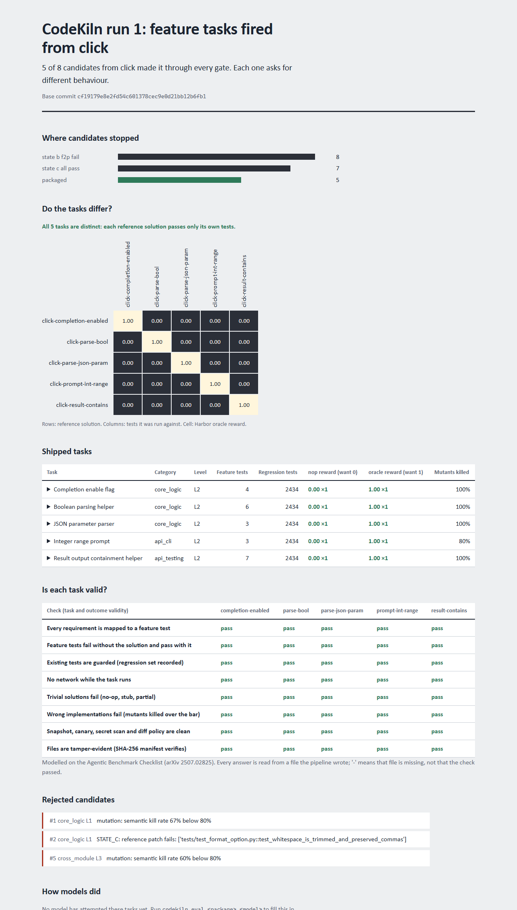
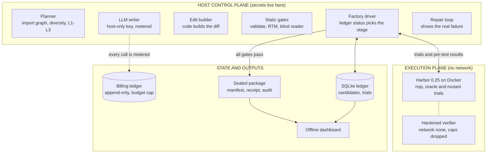
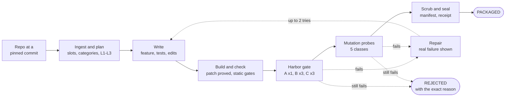
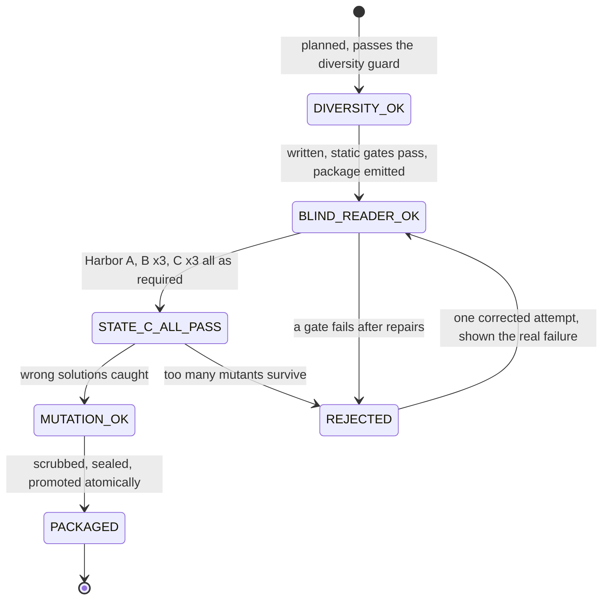
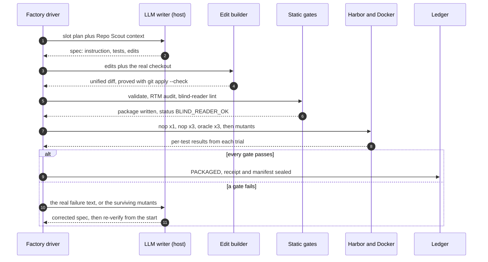

<h1 align="center">CodeKiln</h1>

<p align="center">
  <b>A factory that turns a software repository into validated, tamper-resistant feature tasks<br>for evaluating AI coding agents.</b><br>
  <i>A model may propose. Only execution decides.</i>
</p>

<p align="center">
  <a href="https://github.com/loktrishal-05/CodeKiln/actions/workflows/ci.yml"></a>
  
  
  
  
  
</p>

<p align="center">
  <a href="#results-at-a-glance">Results</a> &middot;
  <a href="#system-architecture">Architecture</a> &middot;
  <a href="#workflow">Workflow</a> &middot;
  <a href="#in-depth">In depth</a> &middot;
  <a href="#security-model">Security</a> &middot;
  <a href="#quick-start">Quick start</a> &middot;
  <a href="#cli-reference">CLI</a> &middot;
  <a href="docs/TECHNICAL.md">Technical notes</a>
</p>

---

## Why CodeKiln

Benchmarks for AI coding agents need tasks that are **new** (not memorised from training data), **fair** (the tests check what the instruction says) and **hard to game** (an agent cannot pass by editing the tests). Writing them by hand does not scale, and asking a language model to write them and trust its word does not work: in our first real runs, models produced patches that did not apply, tests that called code the patch never added, and "tests" that could not tell a right answer from a wrong one.

CodeKiln keeps the model, but takes away its authority. It reads a repository at a pinned commit, plans where new features could go, lets a model **propose** a feature (instruction, solution, tests), and then makes every claim earn its place by **running** it: in a sandbox, several times, against deliberately wrong solutions and cheating agents. What comes out is a [Harbor](https://harborframework.com) task package that the judges' own commands (`harbor run -a nop` and `-a oracle`) will score as `0.0` and `1.0`.

> **The one rule.** Models propose; code and execution decide. No status in the ledger is ever set from what a model says.

## Results at a glance

A real end-to-end run on `pallets/click` **8.5.1** (`cf19179e8e2f`) with a free-tier model (`openai/gpt-oss-120b` on Groq) and Harbor 0.25 on Docker:

| | |
|---|---|
| Candidates planned | **8** |
| Packaged (passed every gate) | **5** |
| Rejected, with the exact reason recorded | 3 (mutation kill rate 67% and 60%, one feature test failing against its own reference patch) |
| Each package, graded by the real Harbor commands | `nop` reward **0.0**, `oracle` reward **1.0**; click's own **2,434** tests stay green |
| Cross-task variation matrix | perfect diagonal: **1.00** on it, **0.00** on all 20 off-diagonal cells |
| Red team (4 cheat attempts x 5 packages) | **20 of 20** scored 0.0; no package blocked |
| Model spend | $0 (free tier; every call is metered in an append-only ledger) |

| Package | Category | Repairs used | Mutants killed |
|---|---|---|---|
| `click-completion-enabled` | core logic | 0 | 100% |
| `click-parse-bool` | core logic | 2 | 100% |
| `click-parse-json-param` | core logic | 2 | 100% |
| `click-prompt-int-range` | API / CLI | 0 | 80% (exactly the bar) |
| `click-result-contains` | API / testing | 0 | 100% |

All five are in [`samples/`](samples/) with their Harbor `nop`/`oracle` results, the matrix, the red-team reports and the dashboard. The offline dashboard (`samples/factory_report.html`, built by `codekiln report`):

<p align="center">
  
</p>

**Honest limits** (details in [Limitations](#limitations-and-status)): all five packages are difficulty level L2 although the planner aims for an L1/L2/L3 mix; the multi-model solve-rate evaluation has not been run; the pipeline was exercised on one repository.

## System architecture

CodeKiln is split into a **host control plane**, which holds the secrets and makes every decision, and an **execution plane**, where untrusted code runs in throwaway containers with no network. Models are reachable only from the host.



| Layer | This prototype | Production path |
|---|---|---|
| Orchestration | Typed Python state machine driven by the ledger; optional model that only *orders* allowed actions | Durable workflow engine |
| Sandbox | Harbor 0.25 on Docker: the same path the judges use | Harbor on Modal, Daytona or Kubernetes |
| Storage | SQLite (WAL) ledger plus atomic file-system packages | PostgreSQL, object storage |
| Interface | Typer CLI plus a static, offline HTML report | Review portal |

### Components

| Area | Module | Responsibility |
|---|---|---|
| Ingestion | `ingestion/repo_loader.py` | Clone a URL, directory or zip at a pinned commit, never executing it |
| Planning | `planner/` | Import graph, category assignment, diversity guard, difficulty dial |
| Synthesis | `synthesis/` | Writer, edit-based diffs, Repo Scout context, RTM audit, package emitter, ideator |
| Execution | `validation/harbor_runner.py`, `gate_runner.py`, `three_state_gate.py`, `verify.py` | Run Harbor trials and decide the 3-state gate from per-test results |
| Strength | `validation/mutation_probe.py`, `adversarial.py`, `test_critic.py` | Prove the tests catch wrong solutions |
| Anti-cheating | `validation/red_team.py`, `verifier_sandbox.py`, `packaging/scrubber.py` | Cheat attempts, isolated grading, single-commit and secret scans |
| Packaging | `packaging/` | Harbor layout, receipt, manifest, atomic promotion |
| Control | `factory.py`, `orchestrator.py`, `repair.py`, `pipeline.py` | Resumable driver, optional action-ordering agent, evidence-based repair |
| Evaluation | `evaluation/` | Dashboard, variation matrix, blind panel, calibration (Rasch IRT) |
| Ledgers | `db.py`, `billing/ledger.py` | Candidate state, trials, metered spend |

## Workflow

### The pipeline



### Candidate lifecycle

Every candidate is a row in the ledger. Its status, not a model, picks the next stage, so a run can be stopped and resumed at any point.



The full state list lives in [`states.py`](src/codekiln/states.py) and [docs/SPEC.md](docs/SPEC.md).

### One slot, end to end



### What Harbor runs for each candidate

| Run | Agent | Solution applied | Must show |
|---|---|---|---|
| **A** x1 | `nop` | no | Original repo: record which existing tests pass (these become the regression set) |
| **B** x3 | `nop` | no | New feature tests **fail** (the feature does not exist yet); existing tests still pass |
| **C** x3 | `oracle` | reference patch | New tests **pass** and every regression test still passes |
| **Mutants** | `oracle` | a deliberately wrong patch | Reward below 1.0 (the tests noticed) |

A feature test that flips between repeats rejects the candidate; a flaky existing test is quarantined and excluded. The reward is the judges' formula: any regression test failing gives `0.0`, otherwise `passed feature tests / feature tests`.

## Design principles

1. **Models propose, execution decides.** Gates read per-test results from Harbor; nothing a model reports about itself counts.
2. **Fail with a reason.** Every rejection records the exact gate and evidence, and the dashboard lists them.
3. **Resumable by construction.** The ledger status drives the pipeline; re-running skips finished work and never repeats a paid call.
4. **Secrets stay on the host.** API keys never enter a container, an image or a log.
5. **Judge parity.** We run the same `harbor run -a nop|oracle` commands the judges run, so a package that passes our gate passes theirs.
6. **Prove variation by execution,** not by file overlap.
7. **Small and boring.** Standard library first, no SDK for the model, no new dependency until a roadmap item needs one.

## In depth

<details>
<summary><b>1. Ingestion</b>: treating the source repo as hostile</summary>

`repo_loader` accepts a git URL, a directory or a zip and returns the pinned `base_commit` (`HEAD`, or `--commit`). Nothing from the repo is executed. Git runs with `core.hooksPath` pointed at the null device, `protocol.ext.allow=never` and `core.autocrlf=false`; local repos are cloned with `--no-hardlinks`; zip entries are rejected on path escape or symlink. A failed load deletes the destination so a half-loaded workspace is never reused.
</details>

<details>
<summary><b>2. Planning and variation by construction</b></summary>

The planner parses the repo with `ast`, builds a file-level import graph and treats each module with public symbols and its dependents (reverse BFS, depth 2) as a candidate *slot*. It only **locates** where a feature could live; tasks always start from the unmodified commit and the feature must not exist upstream. Slots are assigned to five categories (core logic, API/CLI, validation, persistence, cross-module). A **diversity guard** rejects any candidate whose file-and-symbol Jaccard overlap with an accepted one is 0.4 or more, and a **difficulty dial** (L1/L2/L3 from file, directory and dependent counts) balances the mix. This stage is deterministic for a given commit and uses no model.
</details>

<details>
<summary><b>3. Synthesis</b>: the writer, edits and the static gates</summary>

- **Writer.** One call returns one JSON spec: task name, `instruction.md` with one `- REQ-n:` line per requirement, the requirement-to-test map, feature tests and **edits**. The router is standard-library HTTP against any OpenAI-compatible endpoint, with an explicit `User-Agent`, retries on 429/5xx that honour the provider's own wait time, and secret redaction in error text.
- **Edits, not diffs.** A model cannot know line numbers for a file it cannot see, so its hand-written diffs almost never applied. It now says *where* code goes (`add_import`, `insert_after <symbol>`, `append`, `new_file`; additive only, at most 12 edits); code locates the symbol with `ast`, builds the diff with `difflib` and proves it with `git apply --check`.
- **Repo Scout.** A bounded, deterministic pack of public signatures, dependent counts and existing test names for the files a slot touches, so new code and tests look like they belong. It sits inside an untrusted-content wrapper.
- **Static gates before anything is written.** `validate` (names, test-id shape, no deletions, no edits to tests or CI, well-formed patch), the **RTM audit** (every requirement maps to at least one existing feature test; test imports must be named in the instruction) and the **blind reader** (lints the one file the evaluated agent sees).
</details>

<details>
<summary><b>4. The Harbor gate</b>: three states, per-test, repeated</summary>

`verify` runs Harbor itself and reads each trial's `verifier/results.json` (`{test id: status}`). It records every trial in `validation_executions`, quarantines flaky existing tests and writes `flakiness_quarantine.json`. State A's passing tests define the regression set, which is computed inside the task container because host pytest ids differ. The reward script is the judges' formula, shipped in every package.
</details>

<details>
<summary><b>5. Mutation probes</b>: do the tests actually bite?</summary>

Five classes run as real Harbor oracle trials with a swapped `solution/`: **No-Op**, **Hardcoded Stub** and **Partial** must be killed 100%; **semantic** mutants (flipped booleans and comparisons, `and`/`or`, `is not`, `isinstance`, arithmetic, or a renamed definition when a patch has few literals) must be killed at least **80%**, and at least three must be buildable; **adversarial** mutants (plausible-but-wrong patches written by a model, built from edits) join them. Mutants touch only code: comments, docstrings and string contents are masked, because a mutant that edits a docstring equals the original and can never be killed.
</details>

<details>
<summary><b>6. Evidence-based repair</b></summary>

When a candidate is rejected at State C or by the mutation probes, the writer gets a corrected attempt **shown what really happened**: pytest's own failure text from the failing trial (or the log's tail when `import click` itself broke), or the names of the wrong implementations that still passed. At most two repairs per candidate, billed to it, budget-guarded. The corrected package re-enters at `BLIND_READER_OK` and passes every gate again from the start. The model is never asked whether its work is good.
</details>

<details>
<summary><b>7. Scrubbing, sealing and promotion</b></summary>

The scrubber audits a staged task: a single orphan commit, no editable site-packages leak, no network, a diff policy that rejects edits to tests, runners and CI, a canary and a secret scan. The packager then writes `generation_receipt.json` (gates, per-trial rewards, model, cost, hashes) and `manifest.sha256`, and promotes the directory with an atomic `os.replace`. A package that fails any step is never partially visible.
</details>

<details>
<summary><b>8. Extra validation</b>: red team, isolated verifier, critics</summary>

- **Red team (`red-team`).** Four cheat attempts per package run as real Harbor trials: edit the tests, read hidden files, hardcode answers, tamper with the verifier. Any that scores above 0.0 blocks the package.
- **Isolated verifier (`verify-isolated`).** Grades only the agent's diff in a fresh container with `--network none`, `--cap-drop ALL`, `no-new-privileges` and pid, memory and CPU caps, after rejecting diffs that touch tests, runners or startup hooks.
- **Test critic (`test-critic`).** A model writes a *second* correct implementation; if it fails the feature tests, the tests may be too narrow. It tells that apart from an alternative that merely breaks existing tests.
- **Blind solver panel (`blind-panel`).** Two or three agents solve from `instruction.md` alone; code compares their contractual choices and reports spec ambiguities. It needs real agents, so it is not run in the default prototype.
- **Contamination firewall (`firewall`).** Rejects a feature that a later release of the repo already has, matched structurally and offline.
- **Calibration (`calibrate`).** Compares the planner's difficulty guess with measured solve rates; a Rasch (IRT) fit with item-rest discrimination flags tasks that stronger models fail.
</details>

<details>
<summary><b>9. Control: the driver, the optional agent and the ledgers</b></summary>

`codekiln factory` loops: the ledger status of each candidate names its next stage (`verify`, `probe`, `package`); a stage that does not move its candidate is not retried in that call; a hard step bound applies. With `--agent`, a model may *order* the allowed actions, but code enforces the offered list, falls back to the fixed order on any bad answer, and the stage that runs is always the one the status dictates. Spend is an append-only CSV (`BUDGET_ALLOCATION`, `PREAUTH_HOLD`, `LLM_DEBIT`, `PREAUTH_RELEASE`) behind a hard `--max-budget-usd` breaker. Candidates carry an idempotency key `SHA256(repo|commit|mode|slot)`, so re-runs and resumes are safe.
</details>

<details>
<summary><b>10. The dashboard</b></summary>

`codekiln report RUN_ID` writes one self-contained HTML file (no JavaScript, no CDN, every repo-derived string escaped): the funnel of where candidates stopped, the variation heatmap, the shipped tasks with before/after rewards, a per-task validity checklist modelled on the Agentic Benchmark Checklist, the rejected candidates with their reasons, and model results when an evaluation has been run. Every number traces to a ledger row, a package file or a Harbor result.
</details>

## Package anatomy

Each package is a complete Harbor task plus the evidence that justifies it:

```
click-completion-enabled/
├── instruction.md            the ONLY file the evaluated agent sees
├── task.toml                 schema 1.4; repo, base_commit, license, category, difficulty; network_mode = "no-network"
├── environment/Dockerfile    clones click at the pinned commit, re-inits one orphan commit, editable install
├── solution/                 solve.sh + reference.diff (applied only by the oracle)
├── tests/
│   ├── test.sh               restores pristine tests, copies the feature tests in, runs pytest, then reward.py
│   ├── reward.py             the judges' reward formula
│   ├── fail_to_pass.json     feature tests that must flip from fail to pass
│   ├── pass_to_pass.json     existing tests that must stay green (computed in-container)
│   └── feature/              the new feature tests, hidden until grading
├── rtm_map.json              requirement -> test traceability
├── mutation_dossier.json     which wrong solutions the tests caught
├── security_audit.json       single commit, no network, diff policy, canary, secret scan
├── generation_receipt.json   gates, per-trial rewards, model, cost, hashes
└── manifest.sha256           tamper-evident hashes of every file above
```

## Security model

| Boundary | How it is enforced |
|---|---|
| Untrusted repo | Nothing executed at ingestion; git hooks disabled; zip-slip and symlink escapes rejected; repo text wrapped in `<untrusted_repo_content>` before it reaches a model |
| Untrusted code | Harbor sandbox with `network_mode = "no-network"`; optional hardened verifier (`--network none`, `--cap-drop ALL`, `no-new-privileges`, pids/memory/CPU caps) |
| Secrets | Read from a git-ignored `.env` on the host only; never in Docker `ENV`, images, volumes or logs; key-shaped strings redacted from provider errors |
| Anti-gaming | Single orphan commit, no site-packages leak, diff policy blocks edits to tests, runners, `conftest.py`, CI and startup hooks; four-attack red team; grading from `agent.diff` only |
| Model output | Never trusted: edits are checked against real files, diffs are proved with `git apply --check`, every verdict comes from an executed trial |
| Integrity | SHA-256 manifest and atomic promotion; `samples/` packages verify byte-for-byte straight from Git |

## Variation proof

File overlap shows tasks touch different code; it does not show they ask for different *behaviour*. CodeKiln proves that by execution: `codekiln matrix` runs each package's tests against every other package's reference solution. Distinct tasks give `1.0` on the diagonal and `0.0` off it. On the five shipped packages all 20 off-diagonal cells are `0.00` ([`samples/variation_matrix.json`](samples/variation_matrix.json)). The planner also spreads slots across categories and difficulty levels and applies the diversity guard.

## Quick start

**Requirements:** Python 3.12+, Docker with the **buildx** plugin, and the Harbor CLI (`uv tool install "harbor==0.25.*"`). Docker and Harbor are only needed to *run* packages, not for the unit tests.

```bash
git clone https://github.com/loktrishal-05/CodeKiln && cd CodeKiln
python -m venv .venv && source .venv/bin/activate     # Windows: py -3.12 -m venv .venv ; .venv\Scripts\activate
pip install -e ".[dev]"
cp .env.example .env                                  # Windows: copy .env.example .env
ruff check . && mypy && pytest                        # lint, strict types, tests
codekiln --help
```

**Configure** a model in `.env` (host-only, git-ignored). Any OpenAI-compatible endpoint works:

```ini
CODEKILN_LLM_BASE_URL=https://api.groq.com/openai/v1
CODEKILN_LLM_API_KEY=<your key>
CODEKILN_LLM_MODEL=openai/gpt-oss-120b
CODEKILN_MAX_BUDGET_USD=5.00
```

**Run the factory** (needs Docker and Harbor on `PATH`):

```bash
codekiln factory https://github.com/pallets/click \
  --commit cf19179e8e2fd54c601378cec9e0d21bb12b6fb1 --slots 8
codekiln factory --run-id 1                           # resume a stopped run
```

Or reproduce a whole run with one command: `scripts/demo_run.sh` (use `--dry-run` for ingestion and planning only, with no key or Docker). A root `Dockerfile` builds the factory image.

**Inspect and prove:**

```bash
codekiln matrix packages/* --out variation_matrix.json      # cross-task oracle matrix
codekiln red-team PACKAGE                                   # four cheat attempts in Harbor
codekiln verify-isolated PACKAGE --oracle                   # grade in a hardened container
codekiln report 1 --packages packages --matrix variation_matrix.json --out factory_report.html
```

> **Windows notes.** Create the venv with a 3.12+ interpreter (the default `python` is often 3.10, which pip rejects). Re-run `pip install -e ".[dev]"` after every `git pull`. Docker Desktop must be started by hand if its auto-start is off. Git for Windows may check files out with CRLF; the loader clones with LF on purpose.

## CLI reference

| Command | What it does |
|---|---|
| `factory` | Plan (or resume) a run, then drive every candidate through every gate to a package |
| `run` | Plan candidates from a repo (URL, directory or zip) and record them in the ledger |
| `synth` / `resume` | Synthesize a run's candidates into packages / resume a run from a fresh checkout |
| `ideate` | Propose N specs per slot; a deterministic critic keeps the novel ones |
| `blind-read` | Dry-run the blind reader on a package's agent-visible instruction |
| `spec-check` | Validate a spec (JSON) and write its requirement-to-test map |
| `verify` | Run the 3-state gate with Harbor (nop x N+1, oracle x N) |
| `probe` | Mutation probes; `--adversarial N` adds model-written wrong solutions |
| `test-critic` | Stress the feature tests with an independently written correct solution |
| `red-team` | Run cheat attempts in Harbor; block the package if any scores |
| `verify-isolated` | Grade an agent diff in a fresh, network-isolated container |
| `scrub` / `package` | Audit a staged task / seal it and promote it atomically |
| `firewall` | Flag a package whose feature a later release already has |
| `eval` / `blind-panel` | Blind-evaluate packages with real agents / report spec ambiguities |
| `calibrate` | Compare the difficulty guess with measured solve rates |
| `matrix` | Cross-task oracle matrix |
| `report` | Build the static HTML dashboard |

## Repository layout

```
src/codekiln/
├── cli.py  config.py  db.py  states.py  pipeline.py  factory.py  orchestrator.py  repair.py
├── ingestion/    repo loader, profiler, cached environment bootstrap
├── planner/      reverse extraction, forward seeds, diversity guard, difficulty dial
├── synthesis/    writer, edits, scout, RTM, emitter, ideator
├── validation/   Harbor runner, gates, mutation probes, red team, isolated verifier, critics, firewall
├── packaging/    Harbor layout, scrubber, packager
├── evaluation/   dashboard, variation matrix, blind panel, calibration, grader
├── billing/      append-only cost ledger and budget breaker
└── templates/    Dockerfile and report templates
tests/{unit,integration,security}      samples/      scripts/      docs/
```

## What real runs taught us

Running the pipeline for real exposed bugs that unit tests could not. Each is fixed and pinned by a regression test; the full log is in [docs/TECHNICAL.md](docs/TECHNICAL.md).

| Found on a real run | Fix |
|---|---|
| Model-written diffs did not apply | Model sends edits; code builds and proves the diff |
| Windows wrote `\r\n` and used cp1252 | UTF-8 and LF everywhere, enforced by tests |
| A repair that hid `import click` errors | Show the log tail when pytest ran no test |
| Mutants edited docstrings, so good tests scored 0% | Mutate code only; more operators for decision-heavy patches |
| A "cheat" read `/solution`, visible only to the oracle | Red team searches elsewhere |
| Free-tier request limits (403, 429, 413, empty replies) | User-Agent, wait-and-retry, capped output budget, one retry |
| The re-run script produced zero packages | It now drives `codekiln factory` |

## Limitations and status

- **Difficulty mix.** All five packages are level L2. Planned L1 and L3 candidates did not survive the gates.
- **One repository.** The pipeline ran on `pallets/click`; the Python-AST planner and mutation operators are Python-specific.
- **Not measured.** Whether the ideator beats the single writer, and real-model solve rates (the blind panel and multi-model `eval` run named Harbor agents inside the container, which would need provider keys there, against our no-secrets-in-containers rule).
- **Not yet re-run end to end** through `scripts/demo_run.sh` (about 2.5 hours); the `factory` command it calls is what produced the shipped packages.
- **Roadmap.** 31 of 35 items done; remaining: submission video and deck, replay viewer, live trace view, the end-to-end script re-run. See [docs/ROADMAP.md](docs/ROADMAP.md).
- **License.** No license file has been added to this repository yet.

## Team

Built by four contributors for the Innodata Frontier AI Hackathon 2026 (Track 1).

| Member | GitHub | Focus |
|---|---|---|
| Loktrishal K | [@loktrishal-05](https://github.com/loktrishal-05) | Pipeline core, synthesis, factory driver, real runs |
| Sanjjith B | [@Sanjjith27](https://github.com/Sanjjith27) | Synthesizer and ledgers, mutation probes, critics, blind panel, evaluation runner |
| Harshavardhan K | [@Harsha-code-per](https://github.com/Harsha-code-per) | Reports, dashboard, submission assets |
| Cholan Abhaynadh Kinnera | [@Cholan-kinnera](https://github.com/Cholan-kinnera) | Sandbox, Harbor runner, packaging, CI, red team, isolated verifier |

Ground rules: one branch and PR per roadmap item, never commit to `main`, checks must pass (`ruff check . && mypy && pytest`), generated output is never committed (the sealed `samples/` are the one documented exception). See [CONTRIBUTING.md](CONTRIBUTING.md).

## Documentation

| Doc | What is in it |
|---|---|
| [docs/TECHNICAL.md](docs/TECHNICAL.md) | Design decisions, measured results, every model and tool used, assumptions, the manual-fix log |
| [docs/SPEC.md](docs/SPEC.md) | Official rules, package layout, state machine, trust boundaries, artifacts |
| [docs/ROADMAP.md](docs/ROADMAP.md) | Waves and PR-sized tasks, with status |
| [docs/SYNTHESIS.md](docs/SYNTHESIS.md) | The contract writers (models, fixtures) must satisfy |
| [samples/README.md](samples/README.md) | The five shipped packages and their evidence |
